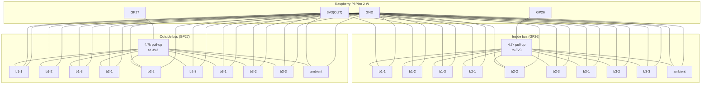

# Box Hardware

This is the second-generation hardware: a single Raspberry Pi Pico 2 W running
**both** sides of a wall assembly's sensor set at once (instead of the
proof-of-concept's one standalone, battery-powered Pico per side — see
`../hardware/`, which stays as-is for any unit still built that way).

This unit is **hard-wired** (mains/DC powered, not battery) and runs
continuously — no deep sleep, no power budgeting. It just loops, taking a
reading every 5 minutes, for as long as it's plugged in.

### Requirements

- Raspberry Pi Pico 2 W
- 20x DS18B20 temp sensors (2 sets of 10 — see "A Set" below)
- 2x ~4.7kΩ resistors (one OneWire pull-up per side's bus)
- Common ground + 3.3V distribution to both sides (see "Electrical wiring")
- A permanent 5V (USB) power source — this device is always-on, not battery-powered

### "A Set" (one per side of the wall)

- **9** DS18B20 sensors spaced 6" apart in a 3x3 grid
- **1** DS18B20 sensor for ambient (off the grid)

One set goes inside, one goes outside — 20 sensors total per box.

## Hardware Setup

[Download](https://www.raspberrypi.com/documentation/microcontrollers/micropython.html) the UF2 file for the Pico 2 W. While in BOOTSEL mode, copy the file onto the Pi.

Using Thonny or VSCode with the Raspberry Pi extension, connect and copy every file in
this directory (except `*.example`, `pico_sdk_import.cmake`, and `tools/`) onto the
device, including the `lib/` folder. `main.py` auto-runs on boot — there's no separate
file to launch.

Before deploying, copy `secrets.py.example` to `secrets.py` and fill in your WiFi
credentials (`secrets.py` is gitignored — never commit real credentials). This file is
only a fallback (see the comment in `secrets.py.example`) — WiFi is normally configured
per-test through the captive portal below, and the Nopal API token/project are entered
there too, not baked into `secrets.py`.

## Electrical wiring

One Pico 2 W, two independent OneWire buses — one per side of the wall — each wired
as a standard externally-powered ("3-wire") DS18B20 bus: shared VDD, shared GND, shared
DQ (data) with a single pull-up resistor per bus. Keeping the two sides on separate
GPIOs (rather than one 20-sensor bus) means each side's wiring only has to reach its own
side of the wall, never cross through it, and a sensor that ends up wired to the wrong
side is caught automatically at boot (see `checkWiring()` in `sensors.py`) instead of
needing to be traced by hand.

The diagram below shows the documented default (`GP26` = inside, `GP27` = outside), but
the actual pin-to-side assignment is just `SIDE_PINS` in `sensors.py` — if a given unit
ends up wired the other way around, update `SIDE_PINS` to match reality rather than
re-wiring (the two pins are electrically identical as OneWire buses).

**Per-sensor pinout** (standard DS18B20 / common waterproof-probe color code):

| DS18B20 pin | Waterproof probe wire | Goes to |
| --- | --- | --- |
| VDD | red | `3V3(OUT)` (shared bus rail for that side) |
| GND | black (bare/shield) | `GND` (shared bus rail for that side — common with the Pico's GND) |
| DQ (data) | yellow | that side's GPIO (per `SIDE_PINS` in `sensors.py`), shared bus rail |

**Per side:**

1. Run 3 shared rails (VDD, GND, DQ) out to the 9 grid positions (6" apart in a 3x3
   layout) plus the 1 ambient sensor — all 10 sensors wire in parallel onto the same
   3 rails (daisy-chain/breakout block, whichever is easier to build — OneWire doesn't
   care about topology, just keep stub lengths off the main run short).
2. Put **one** 4.7kΩ resistor between that side's DQ rail and its VDD rail, physically
   near the Pico end of the run (not out at a sensor).
3. Connect VDD to the Pico's `3V3(OUT)` pin, DQ to that side's GPIO, and GND to any
   Pico `GND` pin.

**Both sides share the same `3V3(OUT)` and `GND`** — there's only one Pico, so both
buses are powered from the same two rails; they just each get their own DQ line/GPIO
and their own pull-up resistor.

**Power budget:** each DS18B20 draws roughly 1-1.5mA active, briefly, during a
conversion (idle current is negligible). 20 sensors is on the order of 20-30mA peak,
well inside the Pico 2 W's onboard 3.3V regulator — no separate power supply is needed
for the sensors themselves. The Pico itself is powered continuously over USB/5V from a
permanent supply (this is a hard-wired unit, not a battery deployment).

**Why 3.3V and not 5V:** the Pico's GPIOs are 3.3V logic. Powering the DS18B20s (and
pulling DQ up) to 3.3V keeps the data line's HIGH level compatible with the Pico's
inputs directly. Don't power the sensors from 5V without a level shifter on DQ.

**Wire gauge/length:** at these currents, standard 22-24 AWG sensor/alarm cable
(3-conductor, or 4-conductor with the spare left disconnected) is fine for typical
wall-cavity runs. If a run gets unusually long (many meters) and reads become flaky,
try a lower pull-up value (e.g. 2.2kΩ-3.3kΩ) on that side before suspecting the
sensors themselves.

## Adding a new BoxHardware unit (naming sensors)

Each physical BoxHardware unit's 20 sensors are a hardcoded entry in `box_devices`
(`sensors.py`) — a `device_name -> {side: {position: sensor_id}}` mapping, with
`side` being `"inside"` or `"outside"`. There's no auto-discovery at runtime: a
sensor whose ID isn't in this dict shows up in logs/CSVs as `<side>-<raw id>` with a
"Sensor Not Mapped" warning, and `device_name` is inferred entirely from which sensors
are wired up (never set via the portal), so **this has to be done once before
deploying a new unit**:

1. Wire up one side's 10 DS18B20 sensors to one bus pin and the other side's 10 to the
   other (see "Electrical wiring" above and `SIDE_PINS` in `sensors.py`).
2. Run `tools/identify_sensors.py` on the device (Thonny's Run button, or
   `mpremote connect <port> run tools/identify_sensors.py`). It loops, printing every
   connected sensor's unique ID and live temperature, grouped by side/bus.
3. One at a time, pinch/hold a single sensor and watch which ID's reading jumps (flagged
   with `<-- warming up`) — that, plus which side's group it printed under, tells you
   which physical sensor is which AND confirms it's on the bus you intended. Let it
   cool between sensors to keep it unambiguous. Write down `side/position -> id` (e.g.
   `inside/b1-1`, `inside/b1-2`, ..., `inside/ambient`, `outside/b1-1`, ...,
   `outside/ambient`) as you go.
4. Add a new entry to `box_devices` in `sensors.py` with a short, unique device name
   (e.g. `"box1"`) and the side/position->id mapping you just built.
5. Push the updated `sensors.py` to the device.

If you're building a unit out of sensors **reused** from old standalone HotBox units,
most of this can be automated — cross-reference scanned IDs against
`../hardware/sensors.py`'s `sensor_devices` mapping (every old ID is globally unique,
so a match tells you exactly which old device/position it was) and only pinch-test
whatever doesn't match. This isn't a permanent script in `tools/` since it's a one-off
per unit, but it's a handful of lines wrapped around `tools/identify_sensors.py`'s scan
loop plus a dict lookup against the old mapping.

That device name is what appears as `device_name` in every log line, local CSV row,
and Nopal Vault run this box produces from then on — see `getDeviceName()` in
`sensors.py`. The `side` ("inside"/"outside") is tracked separately alongside it — see
`getSensorSide()` — and is its own column in the CSV/Vault sync.

If a mapped sensor ever shows up on the *wrong* bus (e.g. a wire got moved, or a repair
swapped inside/outside), the device logs a `WIRING MISMATCH` warning on every boot — see
`checkWiring()` in `sensors.py`.

## Configuration (WiFi captive portal)

**Workflow:**

1. Plug the device in. If no test is currently running (no saved config, or the
   previous test's 24h finished), it starts its own WiFi AP named
   `BoxHardware-Setup` and is discoverable/connectable from a phone or laptop.
2. Connect to `BoxHardware-Setup` — a setup page opens automatically (or visit
   `http://192.168.4.1`). It shows a **Device** badge at the top (the device name
   inferred from whichever sensors are currently wired up — see `getBoxDeviceName()`
   in `sensors.py` — or `unmapped` if they aren't in `box_devices` yet), and asks for:
   - **WiFi network / password** — what the box joins for the test.
   - **Nopal API Token** — a sync-scoped token (Profile page → Sync Tokens on
     nopal.build) for pushing readings into your Vault. Leave blank to skip Nopal sync
     entirely (the box still keeps its own local CSV either way).
   - **Nopal Project** (optional) — a project name to sync into (e.g. `sunny`). Leave
     blank to use your Personal space.
3. Submit — the box connects to that WiFi and immediately starts a fixed **24-hour**
   test (there's no duration field; every test runs 24h).
4. At the end of the 24h, the box automatically clears its config and drops back into
   the `BoxHardware-Setup` AP (step 1) — no manual reset needed to start the next test.

If an API token is set, the box ensures a `box-hardware-data` sync-api analysis exists
(inside the chosen project's, or Personal's, `syncs/` folder in the Vault — created
automatically with the right column schema if it doesn't exist yet, and deliberately a
*different* analysis than the original hardware's `hot-box-data`, since this one's rows
carry an extra `side` column) and starts a new run for the test. The run's `<run>.md`
is seeded with the device name and the full list of sensors detected on that first
cycle (id + side + position name), so it's identifiable later without cross-referencing
`sensors.py`. Every ~5-minute cycle appends that cycle's sensor readings as rows to
`syncs/box-hardware-data/<run>.csv`, alongside the box's own local CSV. See `vault.py`.

**Note:** this run description is deliberately plain ASCII — the firmware's frozen
`urequests` module mishandles multi-byte UTF-8 in a POST body (reproducibly turns the
request into a server-side 500), so avoid em dashes, curly quotes, `°`, etc. if you touch
`vault.py`.

## Developer tools (`tools/`)

Not deployed to the device — run these from your machine against a device connected over
USB (requires `pip install mpremote`, and the device must not be open in Thonny/another
serial client at the same time):

- **`reset_device.py`** — backs up `debug.log`/`temperature_data.csv` into a timestamped
  folder under `hot-box/tmp/`, then deletes them plus `config.json` from the device and
  force-resets it, so it boots straight back into the portal instead of continuing
  whatever test is currently running. Useful between test runs.
  `python3 tools/reset_device.py [--keep-data] [--no-reset] [--port ...]`
- **`identify_sensors.py`** — see "Adding a new BoxHardware unit" above. Run *on* the
  device, not from your machine. Scans both side buses at once.

Since this device never deep sleeps, it's always reachable over USB/`mpremote` while
powered on — unlike the battery-powered `../hardware/` units, there's no narrow awake
window to race, and no need for a "stay awake" debug flag.

## Known limitations

- **Timestamps default to 2021-01-01 until the first successful NTP sync** — the RTC
  starts at that default on power-up; `main.py` syncs it over NTP once WiFi connects,
  and re-syncs every cycle after that to correct for drift over long-running tests. If
  WiFi is unavailable at boot, timestamps stay wrong until it reconnects.
- **The captive portal (AP mode) blocks `mpremote`/serial tooling** — while the box is
  showing the `BoxHardware-Setup` AP, it won't respond to `mpremote` connection attempts
  at all. This is expected; it'll be reachable again once WiFi is configured and it's
  back in its normal reading loop.
